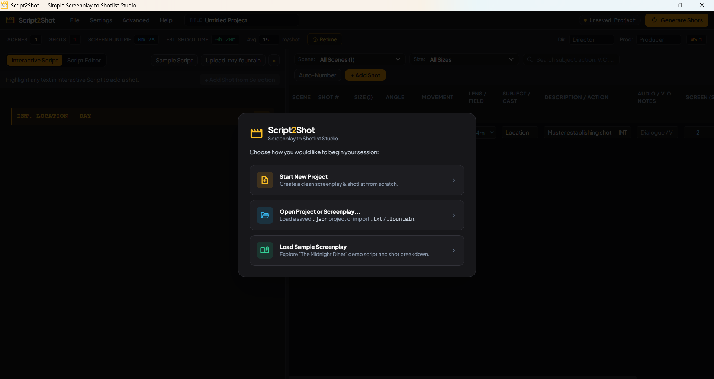
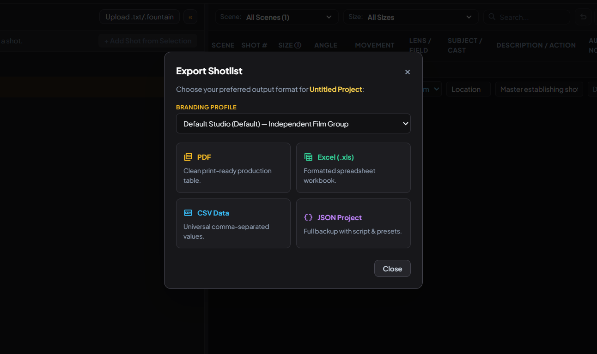
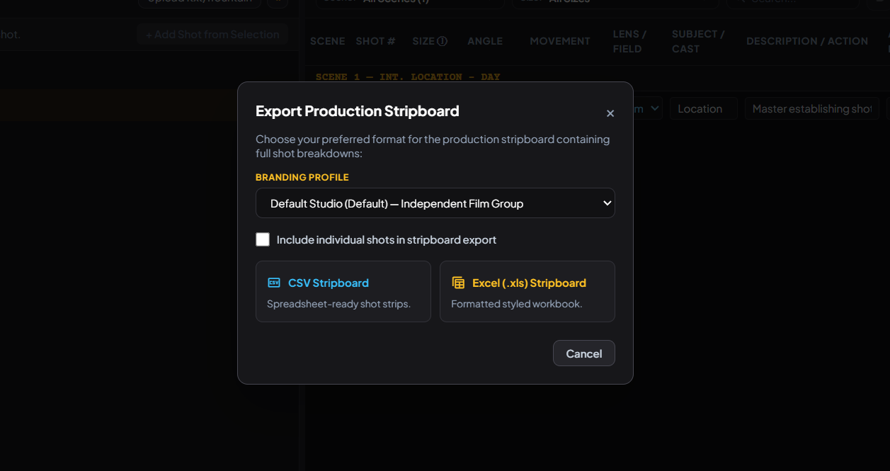
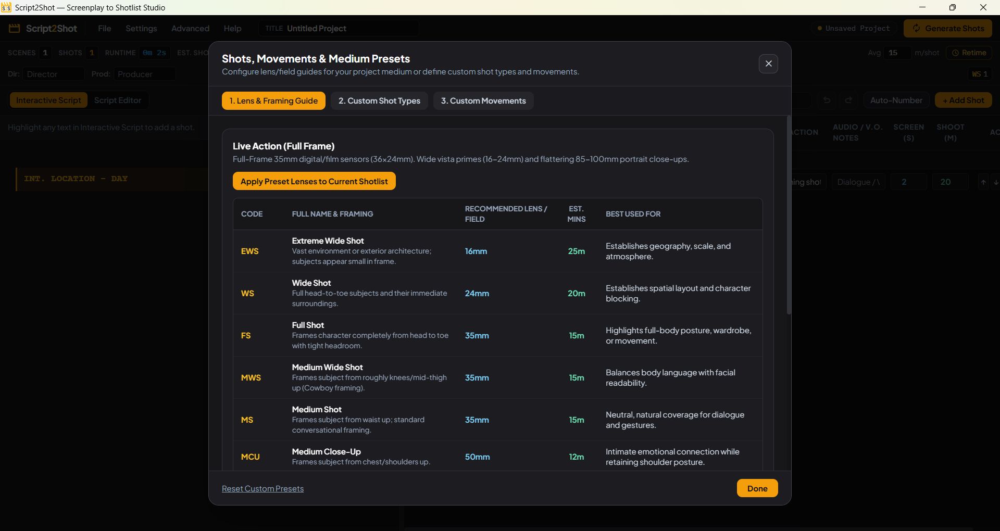
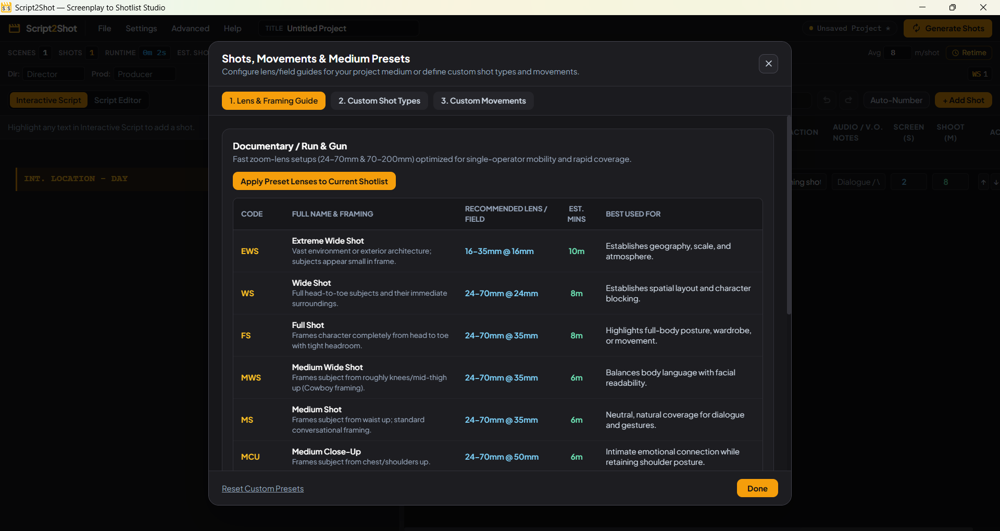
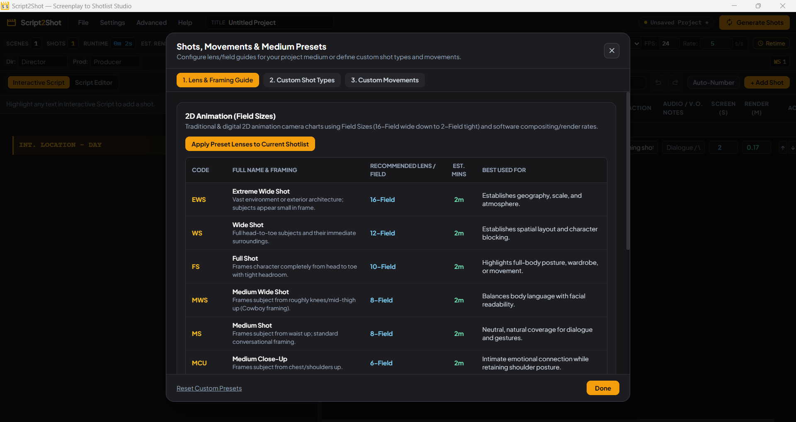
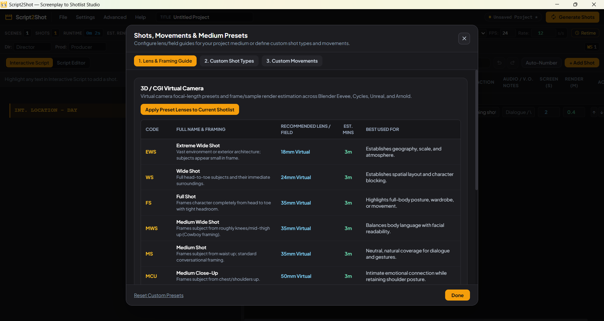
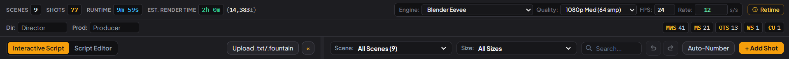
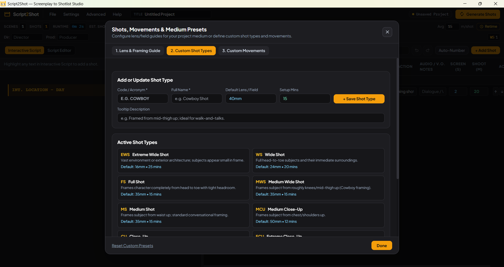
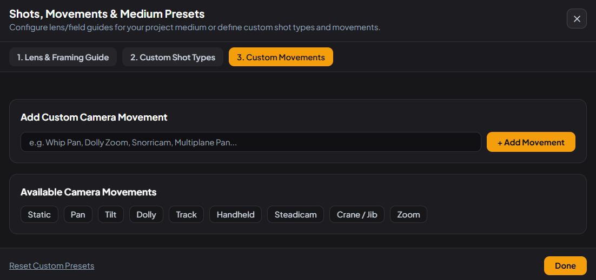

# Script2Shot Official Documentation
Version 1.0.0 | Documentation Last Updated: 23/11/2026

Script2Shot is a deterministic screenplay-to-shotlist desktop studio built to accelerate pre-production for live-action, 2D animation, and 3D/CGI pipelines—with __zero AI__. Plus, Script2Shot also features _Stripboard_ generation.

_All parsing and timing calculations run 100% locally on your machine with zero cloud dependencies, and don't rely on any AI models. Script2Shot generates a structured first-pass baseline in seconds, giving directors and ADs a complete framework ready for rapid fine-tuning, and can export to formats such as Excel, CSV, or JSON, depending on your needs._

## For Indie Creators and Industry Production Companies
Script2Shot cuts hours of initial script breakdown down to seconds by creating most of the shotlist for you, leaving you to spend time on tweaking and fine tuning each shot.

For industry professionals and production companies needing collaboration, Script2Shot supports exports to a variety of formats, including __Excel (.xls)__ and __CSV (.csv)__, which can be opened in Microsoft Excel or Google Sheets for fine tuning or collaboration. Script2Shot also supports exproting Stripboards, sorted by scene type (INT./EXT.), Location, and Time.

For a breakdown of the features that improve industry workflow, see _Specialist Features_.

For indie creators whose shotlist is already finalized inside the app, Script2Shot also exports directly to print-ready A4 landscape PDFs. And the Striboard exporter also has a setting to optionally include shots in the stripboard.

The export settings allow for the use and creation of multiple Branding packs (no account needed), allowing indie creators to use the same tool for multiple purposes, or for professional companies to utilise file versioning via watermarks.

Whatever your needs, Script2Shot is designed to simplify your pre-production workflow with intuitive, easy-to-use UI, full documentation, and easy connection with other tools and platforms in your pipeline.

## Automatic Shoot/Render Time Calculation and Lens Adjustments
Script2Shot automatically adjusts based on any project format, from live action to 3D/CGI, and supports settings for calculating shoot times, or render times based on Blender Cycles or Blender Eevee, with adjustable resolutions and FPS.

Script2Shot eliminates the guesswork by automatically adjusting shot lenses based on project format and shot size/type, making projects easier for indie creators and saving time for professionals whilst still supporting individual lens adjustments to each shot if required.

## Further Documnetation
Script2Shot has extensive documentation, which can be accessed in-app. Further/additional documentation can be found on the github wiki at https://github.com/HeapsEntertainment/Script2Shot/wiki.

# How to Get Started
Script2Shot is designed to be easy and intuative to use, with many automatic features. It is also fully documented in-app, with tutorial guides and explainations for every setting. You might even be reading this within the app.

## Professional Workflow Intergration
If you are an industry professional, or use professional workflows, see the _Professional Workflow Intergration_ page, and the _App Integrations_ page to learn how to add Script2Shot to your pre-production pipeline alongside other exisitng software tools. For a breakdown of the features that improve industry workflow, see _Specialist Features_. 

## Tutorials
If you are band new to Script2Shot, or have never edited a shot list before, please see the _Tutorials_ section. Wether you read every tutorial, or jump to the pages relevant to your project, each tutorial is designed to improve your skills and competence with our intuitive pprogram.

# Professional Workflow Intergration
Script2Shot is a shotlist tool. It is designed to be used before or after creating a storyboard. Script2Shot does not support storyboard creation.
To improve accessiblity and integration, Script2Shot exports to .xls - supported by Microsoft Excel and Google Sheets - and CSV, which is supported be other shotlist tools if required. This means shotlist creation isn't limited soley to Script2Shot - it can be treates as a time-saving starting point to generate and refine the first draft of the shotlist, and then iterated on later in Excel, Sheets, or other software as required.

For a extensive breakdown, see _Specialist Features_. 

## Stripboards

Script2Shot now supports the option to export Stripboards, sorted by scene type (INT./EXT.), Location, and Time. Stripboards can be exported as .csv of .xls format.

Script2Shot also supports a hybrid Stripboard format by including the option to include shots instead of scene headers, organising your shots by location.

## Software Integrations
> To learn more about using and integrating Script2Shot with other apps and software, please see the __App Integrations__ section.

## Multiple Cameras
Script2Shot currently doesn't support multiple camera workflows: however a camera collumn can easily be added in spreadsheet software, such as Microsoft Excel.
> Alternatively, cameras can be indicated by modifying the shot id: for shot 1A, it could either be 1A-A (For Camera A) or 1A-B (For Camera B).

## Industry Standard Support
Script2Shot is designed to adjust each shot automatically based on each projects's preset settings, which are based on industry standard. For example different live action projects have different lense rnages available, which are automatically adjusted based on shot framing.
In additon, 3D/CGI projects also calculate render time estimations based on software & render engine, quality (resolution), FPS, and rate.
If your tool or software is not included in our estimations, please let us know.

# Specialist Features
## Zero-AI, 100% Local Deterministic Breakdown
* Predictable First-Pass Generation: Parses scripts deterministically on your local machine with zero cloud dependencies and no AI guesswork, giving directors and ADs a repeatable baseline in seconds.
* Offline & Studio-Friendly: Runs locally without account requirements or cloud sync constraints, making it easy to slot into early pre-production before moving into shared team spreadsheets.

## Multi-Format Medium Presets & Lens / Field Mapping
* Live Action (Full Frame & Super 35): Maps shot sizes (EWS through ECU, plus INS, OTS, POV, and TWO-SHOT) to sensor-appropriate focal lengths and setup times—from wide primes (16mm Full Frame / 12mm Super 35) to portrait/macro focal lengths (85mm–100mm Macro Full Frame / 65mm–85mm Super 35) and zoom options (24-70mm, 18-55mm).

* Documentary / Run & Gun: Uses practical zoom-at-focal-length presets (16-35mm @ 16mm, 24-70mm @ 24mm/35mm/50mm/70mm, 70-200mm @ 85mm/135mm) tailored for faster setup times and mobile, single-camera, or multi-cam coverage.

* 2D Animation (Field Sizes): Supports traditional and digital animation camera charts (16-Field down to 2-Field, plus Multiplane) with compositing and render-time estimation.

* 3D / CGI Virtual Cameras: Provides virtual/cine/Arnold focal-length presets and Ortho alongside engine-specific render rates.

## Engine-Aware Render Time Estimation (2D & 3D)

* Software & Engine Profiles: Estimates render times across Blender Eevee, Blender Cycles, Unreal Engine (Lumen / Path Tracer), Maya / Arnold Raytracer, Blender Grease Pencil (Eevee & Cycles), Toon Boom Harmony, and TVPaint / Traditional Raster 2D.
* Adjustable Production Parameters: Factors in quality/resolution tiers (1080p and 4K draft/med/high presets, as well as the option to set manual render resolutions), FPS, and render rates so technical directors and producers can gauge compute time early.

## Custom Shot Types, Custom Lenses & Custom Camera Movements

* Custom Shot Types: Define project-specific shot codes/acronyms, full names, default lenses/fields, setup/render minutes, and tooltip descriptions to standardize recurring coverage across an episode or series.
* Manual Overrides & Custom Lens Entry: Override any shot's lens directly in the shotlist or enter custom lens/field values when defining shot types for specialty glass, anamorphic/custom rigs, or non-standard virtual cameras.

* Custom Camera Movements: Expand beyond standard moves (Static, Pan, Tilt, Dolly, Track, Handheld, Steadicam, Crane / Jib, Zoom) by adding custom physical or virtual camera movements (such as Whip Pan, Dolly Zoom, Snorricam, or Multiplane Pan).

_Note: Custom Shot Types & Custom Camera Movements are stored locally in each project, and can't be created globally. A workaround is to create an empty file with your custom presets, and use this file like a template by saving copies of the file when you start a new project. If a shot type is important enough that you use it on a highly regular basis, contact us with your settings._

## Stripboards, Hybrid Shot Stripboards & Pipeline Exports

* Structured Stripboard Exports: Export stripboards sorted by scene type (INT. / EXT.), location, and time of day in .csv or .xls format.
* Hybrid Stripboard Mode: Option to include individual shots organized by location rather than scene headers alone, bridging shot planning and schedule prep.
* Multi-Format Handoffs & Branding: Export to Excel (.xls) and CSV (.csv) for collaborative refinement in Microsoft Excel or Google Sheets, JSON for data exchange, or A4 landscape PDF for print-ready reviews—complete with multiple Branding Packs and watermarking for file versioning.

# How Script2Shot Came about

Script2Shot came about when we - Heaps Entertaiment - were planning an upcoming CGI series, found that sourcing a free, simple shotlist tool - that didn't rely on AI - was not easy to find or access. So, we decided to experiment and create our own tool to improve our existing workflow or relying on Microsoft Excel templates.
We hope this tool is as useful for you as it is for us!

